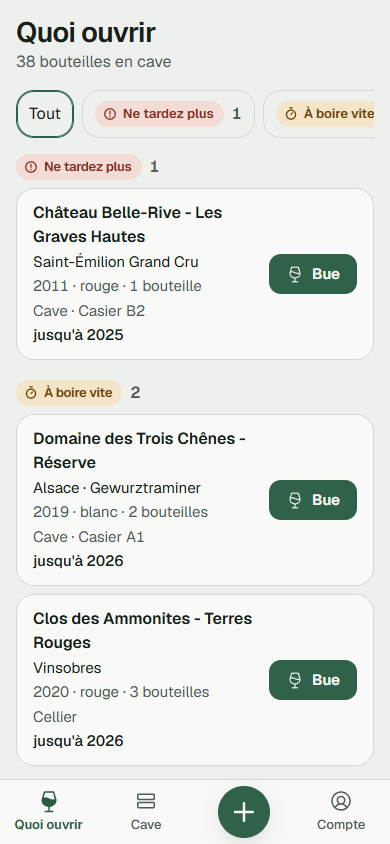
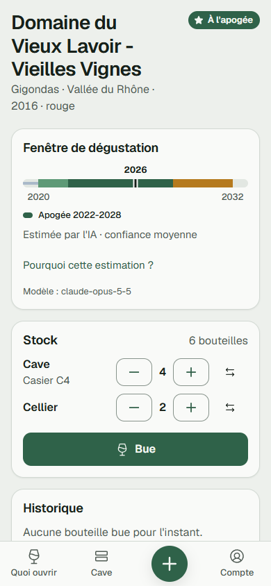
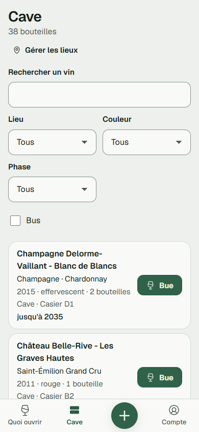

<p align="center">
  
</p>

<h1 align="center">Apogée</h1>

<p align="center">
  Gérer sa cave à vin chez soi, et savoir quelle bouteille ouvrir ce soir.<br>
  <em>A self-hosted wine cellar app that tells you which bottle to open tonight.</em>
</p>

<p align="center">
  <a href="https://github.com/Gavark/apogee/actions/workflows/ci.yml"></a>
  <a href="LICENSE"></a>
  <a href="https://github.com/Gavark/apogee/pkgs/container/apogee"></a>
</p>

<p align="center">
  <a href="#français">Français</a> · <a href="#english">English</a>
</p>

<p align="center">
  <picture>
    <source media="(prefers-color-scheme: dark)" srcset="docs/screenshots/quoi-ouvrir-dark.png">
    
  </picture>
  <picture>
    <source media="(prefers-color-scheme: dark)" srcset="docs/screenshots/fiche-vin-dark.png">
    
  </picture>
  <picture>
    <source media="(prefers-color-scheme: dark)" srcset="docs/screenshots/cave-dark.png">
    
  </picture>
</p>

---

## Français

Apogée est une application web pour gérer une cave à vin à la maison. Chaque vin a une fenêtre de dégustation, et l'écran principal range vos bouteilles par urgence : celles à ne plus attendre en haut, celles qui ont encore besoin de temps en bas.

Elle s'installe sur votre propre serveur avec Docker, et vos données restent chez vous. Sur le téléphone, elle s'utilise comme une application et fonctionne hors ligne, ce qui est pratique au fond d'une cave.

### Fonctionnalités

- **Quoi ouvrir** : les bouteilles en stock groupées par phase (Ne tardez plus, À boire vite, À l'apogée, Prêt, Patience), avec des filtres cumulables.
- **Fenêtre de dégustation** par vin : à boire à partir de, apogée, à boire avant. Vous la saisissez, ou l'IA l'estime.
- **Photo d'étiquette** (facultatif) : l'IA lit l'étiquette et pré-remplit la fiche, que vous corrigez avant d'enregistrer. Anthropic, ou toute API compatible OpenAI, y compris un Ollama local.
- **Stock par lieu** et par emplacement (cave, cellier, casier A3…), avec des gestes rapides : Bue, +/−, déplacer, annuler.
- **Cave** : recherche, filtres par lieu, couleur et phase, historique des bouteilles bues.
- **Hors ligne** : consultation et gestes de stock sans réseau, envoyés au retour de la connexion.
- **Notifications** quand un vin change de phase, et un rappel mensuel des bouteilles à ne pas oublier.
- **Foyers** : plusieurs personnes partagent la même cave, sur invitation.
- **Sauvegardes** automatiques chaque nuit, vérifiées.
- Interface en français et en anglais, selon la langue du navigateur ou le choix fait dans le compte.

### Démarrage rapide (Docker Compose)

```bash
git clone https://github.com/gavark/apogee.git && cd apogee
cp .env.example .env        # puis éditez .env : ORIGIN = URL publique (le défaut est le port de dev 5173)
mkdir -p data && chown 1000:1000 data   # le conteneur tourne avec l'utilisateur "node"
docker compose up -d
```

Le `docker-compose.yml` tire l'image publiée `ghcr.io/gavark/apogee:latest` (amd64 et arm64). Pour la construire localement, décommentez `build: .` et remplacez `image:` en conséquence.

L'application écoute sur `127.0.0.1:3000`. Placez-la derrière un reverse proxy HTTPS (voir [`Caddyfile.example`](Caddyfile.example)) et renseignez son URL publique dans `ORIGIN` : sans cela, les formulaires sont rejetés (403). Ne publiez pas le port 3000 en clair sur Internet.

Les migrations de base de données s'appliquent automatiquement à chaque démarrage. Toutes les données sont dans `./data/` : la base `apogee.sqlite` et le dossier `photos/`.

### Premier lancement

Deux options :

- **Assistant** : ouvrez l'application, vous êtes redirigé vers `/setup` pour créer le premier foyer et le compte administrateur.
- **Variables d'environnement** : définissez `ADMIN_EMAIL` et `ADMIN_PASSWORD` (et `HOUSEHOLD_NAME`) avant le premier démarrage. Le compte n'est créé que si la base ne contient encore aucun utilisateur. Ces variables sont ensuite ignorées.

L'inscription se fait uniquement sur invitation. Les membres d'un foyer invitent leurs proches depuis Compte, puis Foyer. L'administrateur de l'instance invite de nouveaux foyers depuis Administration.

### Configuration

| Variable | Défaut | Rôle |
| --- | --- | --- |
| `ORIGIN` | (vide) | URL publique de l'instance, par exemple `https://cave.example.com`. Obligatoire derrière un proxy. |
| `ADMIN_EMAIL` | (vide) | E-mail du premier administrateur (voir Premier lancement). |
| `ADMIN_PASSWORD` | (vide) | Mot de passe du premier administrateur, 10 caractères minimum. |
| `HOUSEHOLD_NAME` | `Ma cave` | Nom du premier foyer créé au démarrage. |
| `TZ` | `Europe/Paris` | Fuseau horaire de l'instance, utilisé pour les nouveaux comptes et le calcul des phases. |
| `ADDRESS_HEADER` | `x-forwarded-for` (compose) | En-tête portant l'IP réelle du client, posé par le reverse proxy. Sert à la limite de tentatives par IP. |
| `XFF_DEPTH` | `1` (compose) | Nombre de proxys de confiance devant l'application : lit la dernière entrée de `X-Forwarded-For`. |
| `DATABASE_PATH` | `/data/apogee.sqlite` (image) | Chemin du fichier SQLite. Fixé dans l'image, à ne pas changer avec Docker. |
| `AI_PROVIDER` | (vide) | `anthropic` ou `openai-compatible`. Vide : `anthropic` si `AI_API_KEY` est défini, sinon l'analyse IA est désactivée. |
| `AI_API_KEY` | (vide) | Clé d'API du fournisseur. Facultative pour un serveur local (Ollama). |
| `AI_MODEL` | `claude-opus-5-5` (Anthropic) | Modèle utilisé. Obligatoire avec `openai-compatible`. |
| `AI_BASE_URL` | (vide) | Adresse de l'API, obligatoire avec `openai-compatible` (par exemple `https://api.openai.com/v1`). |
| `AI_DAILY_LIMIT_PER_HOUSEHOLD` | `100` | Analyses facturées par jour et par foyer (réussies, ou réponse refusée / inexploitable). `0` = illimité. |
| `VAPID_SUBJECT` | `mailto:admin@` + domaine de `ORIGIN` | Contact transmis aux services de notification push, au format `mailto:vous@exemple.fr`. Facultatif. |
| `PHOTOS_DIR` | `photos/` à côté de la base (`/data/photos` dans l'image) | Dossier des photos d'étiquettes, dans le volume de données. À ne pas changer avec Docker. |
| `BACKUP_RETENTION` | `30` | Nombre de sauvegardes conservées de chaque type (bases et archives de photos) par le conteneur `backup`. |
| `BACKUP_SCHEDULE` | `0 3 * * *` | Horaire cron de la sauvegarde automatique (heure de `TZ`). Par défaut, tous les jours à 3 h. |
| `BODY_SIZE_LIMIT` | `8M` (image) | Taille maximale d'une requête, pour les photos. Hors Docker (`npm start`), définissez-la aussi : adapter-node limite à 512 Ko par défaut et la plupart des photos seraient refusées (erreur 413). |
| `NODE_ENV` | `production` (image) | Fixé par l'image : cookies sécurisés, et la page `/dev/styleguide` répond 404. |

`ADDRESS_HEADER` et `XFF_DEPTH` sont définis dans `docker-compose.yml` parce que le port est lié à `127.0.0.1`, derrière Caddy. Sans eux, tous les clients partageraient la même IP (celle du proxy) et la même limite de tentatives. Si vous exposez le conteneur directement, sans reverse proxy, supprimez ces deux variables : un client pourrait sinon forger `X-Forwarded-For` pour contourner la limite.

### Installer sur le téléphone

Apogée s'installe depuis le navigateur, sans passer par un store.

- **Android** : ouvrez Apogée dans Chrome, connectez-vous, puis menu ⋮ > Installer l'application. Chrome crée une vraie application, avec l'icône d'Apogée seule. Les autres navigateurs Android (Vivaldi, Brave, Firefox…) ne créent qu'un raccourci marqué de leur logo : il fonctionne, mais l'icône est différente.
- **iPhone et iPad** : ouvrez Apogée dans Safari, puis Partager > Sur l'écran d'accueil.

Chaque navigateur a sa propre session, sa copie hors ligne et sa file de gestes. Après une installation depuis un autre navigateur, reconnectez-vous puis réactivez les notifications sur ce nouvel appareil.

### Mode hors ligne

Une fois installée, l'application reste utilisable sans réseau.

**Ce qui marche hors ligne**

- Ouvrir l'application et consulter « Quoi ouvrir », la cave et les fiches déjà vues. Le service worker en garde une copie, propre à chaque compte. À l'ouverture, l'écran reprend la copie la plus récente, y compris les derniers gestes.
- Les gestes de stock : Bue, +/−, déplacer, annuler. Ils s'affichent tout de suite et sont mis en file sur l'appareil. Un indicateur compte les gestes en attente.

**Ce qui demande le réseau** : ajouter ou modifier un vin, les lieux, le compte (mot de passe, sessions), le foyer, les notifications, l'analyse IA de l'étiquette et l'administration. Ces écrans affichent « Cet écran nécessite le réseau » et désactivent l'envoi tant que l'appareil est hors ligne.

**Synchronisation** : les gestes en attente partent au retour du réseau, au retour sur l'application, toutes les 30 s et, selon le navigateur, par Background Sync. Chrome, Edge et Android les envoient même application fermée. Safari et iOS ne les envoient que lorsque l'application est ouverte.

Quand un écran vient de la copie locale, un bandeau « Hors ligne » indique la date des données affichées. Un geste ne part jamais sous un autre compte que celui qui l'a fait. Si vous vous déconnectez avec des gestes non synchronisés, l'application vous prévient et vous propose de rester, ou de vous déconnecter quand même (les gestes sont alors perdus).

### Notifications

Apogée peut vous prévenir quand un vin entre dans une nouvelle phase (à boire, apogée, à boire vite, passé) et, une fois par mois, rappeler les bouteilles à ne pas oublier. Chaque personne les active depuis Compte > Notifications, appareil par appareil, et peut couper séparément les deux types de messages.

- **HTTPS obligatoire** : les navigateurs n'acceptent les notifications que sur une page HTTPS (ou `http://localhost`). Derrière le reverse proxy, `ORIGIN` doit être l'adresse HTTPS publique.
- **iPhone et iPad (iOS 16.4 ou plus)** : ajoutez Apogée à l'écran d'accueil depuis Safari, puis activez les notifications depuis l'application installée. Dans un onglet Safari, la page l'explique et le bouton n'apparaît pas.
- **Android, rien ne s'affiche** : si le test part mais n'arrive pas, la catégorie de notifications « Sites » du navigateur est souvent désactivée. Allez dans Paramètres Android > Applications > Chrome (ou le navigateur utilisé) > Notifications, et activez « Sites ». Retirez aussi de la liste des appareils les anciens abonnements d'un navigateur que vous n'utilisez plus.
- **Heure d'envoi** : au plus une notification par personne et par jour, à partir de 18 h dans le fuseau du compte. Si le serveur était éteint, un seul message regroupe les changements survenus entre-temps.
- Les clés VAPID sont générées au premier usage et conservées dans la base : rien à configurer. `VAPID_SUBJECT` est facultatif.
- Le bouton « Envoyer une notification de test » vérifie qu'un appareil reçoit bien les messages (3 essais par heure).

### Analyse IA de l'étiquette

Facultative. Quand elle est activée, vous photographiez l'étiquette en ajoutant un vin. L'IA pré-remplit la fiche (producteur, appellation, millésime, cépages, fenêtre de dégustation estimée…) et vous corrigez avant d'enregistrer. Elle peut aussi ré-estimer la fenêtre d'un vin existant. Sans configuration, tout le reste fonctionne normalement.

**Anthropic** : renseignez la clé. Le modèle par défaut est `claude-opus-5-5`.

```bash
AI_API_KEY=sk-ant-...
# AI_MODEL=claude-opus-5-5   # facultatif
```

**API compatible OpenAI** (OpenAI, Mistral, OpenRouter, Ollama local…) :

```bash
AI_PROVIDER=openai-compatible
AI_BASE_URL=https://api.openai.com/v1
AI_API_KEY=sk-...
AI_MODEL=gpt-4o          # un modèle qui accepte les images
```

Avec Ollama sur l'hôte et Apogée dans Docker : `AI_BASE_URL=http://host.docker.internal:11434/v1`, sans clé, avec un modèle qui accepte les images. Sous Linux, ajoutez au service dans `docker-compose.yml` :

```yaml
    extra_hosts:
      - "host.docker.internal:host-gateway"
```

- **Coût** : environ 1,5 à 2 centimes de dollar par étiquette avec le modèle par défaut (mesuré : environ 2 300 tokens en entrée, 300 à 450 en sortie, 5 à 6 s), facturés par le fournisseur sur votre compte.
- **Confidentialité** : seule la photo de l'étiquette part chez le fournisseur choisi, avec les indices déjà saisis (producteur, millésime…). Avec un Ollama local, rien ne quitte votre réseau. Les photos restent sur votre serveur, dans `data/photos/`.
- **Limite quotidienne** : `AI_DAILY_LIMIT_PER_HOUSEHOLD` (100 par défaut) protège votre budget, avec un compteur par foyer.
- **Vérifier la configuration** : la page Administration affiche le fournisseur, le modèle et le nombre d'analyses du jour, avec un bouton de test (un appel réel, quelques centimes). La clé n'est jamais affichée.

### Sauvegardes

Le `docker-compose.yml` lance un conteneur `backup` qui sauvegarde chaque nuit la base SQLite et le dossier `data/photos/` dans `./backups/`, vérifie le résultat et ne garde que les dernières copies (`BACKUP_RETENTION`, `BACKUP_SCHEDULE`). Copiez `backups/` hors de la machine : une sauvegarde sur le même disque ne protège pas d'une panne de ce disque.

La sauvegarde à la demande, la restauration et les détails sont dans [docs/BACKUP.md](docs/BACKUP.md). Sous Windows, [`scripts/sync-backups-offsite.ps1`](scripts/sync-backups-offsite.ps1) copie les sauvegardes vers un dossier synchronisé (Google Drive, OneDrive…) : voir [la section dédiée](docs/BACKUP.md#hôte-windows--tâche-planifiée--dossier-synchronisé).

### Mise à jour

```bash
git pull
docker compose pull
docker compose up -d
```

Les migrations sont additives et appliquées au démarrage. Faites une sauvegarde avant de mettre à jour.

### Développement

```bash
npm install
cp .env.example .env
npm run db:migrate   # crée ./data/apogee.sqlite
npm run dev          # serveur de développement
npm test             # tests (Vitest)
npm run check        # svelte-check et TypeScript
```

Stack : SvelteKit et Svelte 5, SQLite avec Drizzle, Paraglide pour les traductions, Vitest pour les tests.

### Licence

[AGPL-3.0-only](LICENSE). Vous pouvez utiliser, modifier et héberger Apogée librement. Si vous proposez une version modifiée à d'autres personnes par le réseau, vous devez aussi leur donner accès à son code source.

---

## English

Apogée is a web app for managing a home wine cellar. Each wine has a drinking window, and the main screen sorts your bottles by urgency: the ones that shouldn't wait any longer at the top, the ones that still need time at the bottom.

You run it on your own server with Docker, and your data stays with you. On a phone it installs like an app and works offline, which helps at the back of a cellar.

### Features

- **What to open**: bottles in stock grouped by phase (Overdue, Drink soon, At its peak, Ready, Not yet), with filters you can combine.
- **Drinking window** for each wine: drink from, peak, drink by. You enter it, or the AI estimates it.
- **Label photo** (optional): the AI reads the label and fills in the wine sheet, which you check before saving. Works with Anthropic or any OpenAI-compatible API, including a local Ollama.
- **Stock by location** and position (cellar, pantry, rack A3…), with quick actions: Drunk, +/−, move, undo.
- **Cellar**: search, filters by location, colour and phase, history of bottles drunk.
- **Offline**: browse and update stock without a connection. Changes are sent when you are back online.
- **Notifications** when a wine changes phase, plus a monthly reminder of bottles not to forget.
- **Households**: several people share one cellar, by invitation.
- **Backups** every night, verified.
- French and English interface, following the browser language or the choice made in the account.

### Quick start (Docker Compose)

```bash
git clone https://github.com/gavark/apogee.git && cd apogee
cp .env.example .env        # then edit .env: ORIGIN = public URL (the default is dev port 5173)
mkdir -p data && chown 1000:1000 data   # the container runs as the "node" user
docker compose up -d
```

`docker-compose.yml` pulls the published image `ghcr.io/gavark/apogee:latest` (amd64 and arm64). To build it locally, uncomment `build: .` and adjust `image:`.

The app listens on `127.0.0.1:3000`. Put it behind an HTTPS reverse proxy (see [`Caddyfile.example`](Caddyfile.example)) and set its public URL in `ORIGIN`. Without it, forms are rejected (403). Don't expose port 3000 to the Internet in plain HTTP.

Database migrations run automatically on every start. All data lives in `./data/`: the `apogee.sqlite` database and the `photos/` folder.

### First start

Two options:

- **Setup wizard**: open the app and you are redirected to `/setup` to create the first household and the admin account.
- **Environment variables**: set `ADMIN_EMAIL` and `ADMIN_PASSWORD` (and `HOUSEHOLD_NAME`) before the first start. The account is created only if the database has no user yet. These variables are ignored afterwards.

Sign-up is by invitation only. Household members invite people from Account, then Household. The instance admin invites new households from Administration.

### Configuration

| Variable | Default | Purpose |
| --- | --- | --- |
| `ORIGIN` | (empty) | Public URL of the instance, for example `https://cellar.example.com`. Required behind a proxy. |
| `ADMIN_EMAIL` | (empty) | Email of the first admin (see First start). |
| `ADMIN_PASSWORD` | (empty) | Password of the first admin, at least 10 characters. |
| `HOUSEHOLD_NAME` | `Ma cave` | Name of the first household created at start-up. |
| `TZ` | `Europe/Paris` | Time zone of the instance, used for new accounts and for computing phases. |
| `ADDRESS_HEADER` | `x-forwarded-for` (compose) | Header carrying the client's real IP, set by the reverse proxy. Used by the per-IP attempt limit. |
| `XFF_DEPTH` | `1` (compose) | Number of trusted proxies in front of the app: reads the last entry of `X-Forwarded-For`. |
| `DATABASE_PATH` | `/data/apogee.sqlite` (image) | Path of the SQLite file. Set in the image; don't change it with Docker. |
| `AI_PROVIDER` | (empty) | `anthropic` or `openai-compatible`. Empty: `anthropic` if `AI_API_KEY` is set, otherwise AI analysis is off. |
| `AI_API_KEY` | (empty) | Provider API key. Optional for a local server (Ollama). |
| `AI_MODEL` | `claude-opus-5-5` (Anthropic) | Model to use. Required with `openai-compatible`. |
| `AI_BASE_URL` | (empty) | API address, required with `openai-compatible` (for example `https://api.openai.com/v1`). |
| `AI_DAILY_LIMIT_PER_HOUSEHOLD` | `100` | Billed analyses per day and per household (successful, or a refused / unusable answer). `0` = unlimited. |
| `VAPID_SUBJECT` | `mailto:admin@` + `ORIGIN` domain | Contact sent to push services, as `mailto:you@example.com`. Optional. |
| `PHOTOS_DIR` | `photos/` next to the database (`/data/photos` in the image) | Folder for label photos, inside the data volume. Don't change it with Docker. |
| `BACKUP_RETENTION` | `30` | Number of backups of each kind (databases and photo archives) kept by the `backup` container. |
| `BACKUP_SCHEDULE` | `0 3 * * *` | Cron schedule of the automatic backup (in `TZ`). Every day at 3 am by default. |
| `BODY_SIZE_LIMIT` | `8M` (image) | Maximum request size, for photos. Outside Docker (`npm start`), set it too: adapter-node defaults to 512 KB and most photos would be rejected (error 413). |
| `NODE_ENV` | `production` (image) | Set by the image: secure cookies, and `/dev/styleguide` returns 404. |

`ADDRESS_HEADER` and `XFF_DEPTH` are set in `docker-compose.yml` because the port is bound to `127.0.0.1`, behind Caddy. Without them, every client would share the proxy's IP and the same attempt limit. If you expose the container directly, without a reverse proxy, remove both variables: otherwise a client could forge `X-Forwarded-For` to get around the limit.

### Install on a phone

Apogée installs from the browser, no app store involved.

- **Android**: open Apogée in Chrome, sign in, then menu ⋮ > Install app. Chrome creates a real app, with the plain Apogée icon. Other Android browsers (Vivaldi, Brave, Firefox…) only add a shortcut badged with their logo: it works, but the icon looks different.
- **iPhone and iPad**: open Apogée in Safari, then Share > Add to Home Screen.

Each browser has its own session, offline copy and queue of pending changes. After installing from another browser, sign in again and turn notifications back on for that device.

### Offline mode

Once installed, the app keeps working without a network.

**What works offline**

- Opening the app and browsing "What to open", the cellar and wine sheets you have already seen. The service worker keeps a copy for each account. On launch, the screen uses the most recent copy, including your latest changes.
- Stock actions: Drunk, +/−, move, undo. They show up at once and are queued on the device. A counter shows how many are pending.

**What needs the network**: adding or editing a wine, locations, account settings (password, sessions), household, notifications, AI label analysis and administration. These screens show "This screen needs a network connection" and disable sending while the device is offline.

**Sync**: pending changes are sent when the network comes back, when you return to the app, every 30 s and, depending on the browser, through Background Sync. Chrome, Edge and Android send them even with the app closed. Safari and iOS only send them while the app is open.

When a screen comes from the local copy, an "Offline" banner shows the date of the data. A change is never sent under another account than the one that made it. If you sign out with unsynced changes, the app warns you and lets you stay, or sign out anyway (the changes are then lost).

### Notifications

Apogée can tell you when a wine enters a new phase (ready, peak, drink soon, past) and, once a month, remind you of bottles not to forget. Each person turns them on from Account > Notifications, device by device, and can switch off the two kinds of messages separately.

- **HTTPS required**: browsers only allow notifications on HTTPS pages (or `http://localhost`). Behind the reverse proxy, `ORIGIN` must be the public HTTPS address.
- **iPhone and iPad (iOS 16.4 or later)**: add Apogée to the Home Screen from Safari, then turn on notifications from the installed app. In a Safari tab, the page explains this and the button is hidden.
- **Android, nothing shows up**: if the test is sent but never arrives, the browser's "Sites" notification category is often turned off. Go to Android Settings > Apps > Chrome (or the browser you use) > Notifications, and turn on "Sites". Also remove old subscriptions of browsers you no longer use from the device list.
- **Delivery time**: at most one notification per person per day, from 6 pm in the account's time zone. If the server was down, a single message covers the changes in between.
- VAPID keys are generated on first use and stored in the database: nothing to configure. `VAPID_SUBJECT` is optional.
- The "Send a test notification" button checks that a device receives messages (3 tries per hour).

### AI label analysis

Optional. When it is on, you take a photo of the label while adding a wine. The AI fills in the wine sheet (producer, appellation, vintage, grapes, estimated drinking window…) and you correct it before saving. It can also re-estimate the window of an existing wine. Without configuration, everything else works as usual.

**Anthropic**: set the key. The default model is `claude-opus-5-5`.

```bash
AI_API_KEY=sk-ant-...
# AI_MODEL=claude-opus-5-5   # optional
```

**OpenAI-compatible API** (OpenAI, Mistral, OpenRouter, local Ollama…):

```bash
AI_PROVIDER=openai-compatible
AI_BASE_URL=https://api.openai.com/v1
AI_API_KEY=sk-...
AI_MODEL=gpt-4o          # a model that accepts images
```

With Ollama on the host and Apogée in Docker: `AI_BASE_URL=http://host.docker.internal:11434/v1`, no key, and a model that accepts images. On Linux, add this to the service in `docker-compose.yml`:

```yaml
    extra_hosts:
      - "host.docker.internal:host-gateway"
```

- **Cost**: about 1.5 to 2 US cents per label with the default model (measured: about 2,300 input tokens, 300 to 450 output tokens, 5 to 6 s), billed by the provider to your account.
- **Privacy**: only the label photo goes to the provider you chose, along with any hints already typed in (producer, vintage…). With a local Ollama, nothing leaves your network. Photos stay on your server, in `data/photos/`.
- **Daily limit**: `AI_DAILY_LIMIT_PER_HOUSEHOLD` (100 by default) protects your budget, with one counter per household.
- **Check the setup**: the Administration page shows the provider, the model and today's analysis count, with a test button (one real call, a few cents). The key is never displayed.

### Backups

`docker-compose.yml` starts a `backup` container that saves the SQLite database and the `data/photos/` folder to `./backups/` every night, verifies the result and keeps only the latest copies (`BACKUP_RETENTION`, `BACKUP_SCHEDULE`). Copy `backups/` off the machine: a backup on the same disk won't survive that disk failing.

On-demand backups, restore steps and details are in [docs/BACKUP.md](docs/BACKUP.md) (in French). On Windows, [`scripts/sync-backups-offsite.ps1`](scripts/sync-backups-offsite.ps1) copies backups to a synced folder (Google Drive, OneDrive…).

### Updating

```bash
git pull
docker compose pull
docker compose up -d
```

Migrations are additive and run at start-up. Take a backup before updating.

### Development

```bash
npm install
cp .env.example .env
npm run db:migrate   # creates ./data/apogee.sqlite
npm run dev          # dev server
npm test             # tests (Vitest)
npm run check        # svelte-check and TypeScript
```

Stack: SvelteKit and Svelte 5, SQLite with Drizzle, Paraglide for translations, Vitest for tests.

### License

[AGPL-3.0-only](LICENSE). You are free to use, modify and host Apogée. If you offer a modified version to other people over a network, you must also give them access to its source code.
